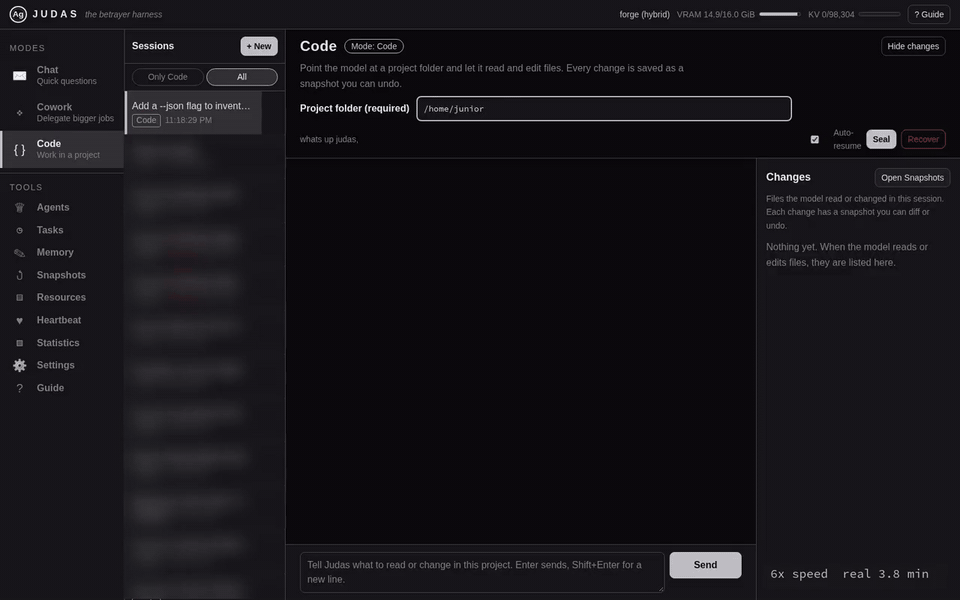

# Judas

[Website](https://judas.sanchezlabs.us) · [Docs](docs/) · [Support on Ko-fi](https://ko-fi.com/sanchezperformance)

### A team of coding agents on your own GPU. Not one at a time: all at once.

A single local agent leaves most of your GPU idle while it writes. Judas loads one model and runs a lead agent plus workers on it in parallel, so a job that splits gets done in a fraction of the time, and nothing leaves your machine.

| Agents on one GPU | Total tok/s | Each agent |
|---|---|---|
| 1 | 113 | 113 |
| 2 | 164 | 82 |
| 4 | 221 | 55 |
| 6 | 248 | 41 |

Same GPU, same model, no second copy in memory. Measured on one RX 6800 (16 GB, Vulkan) with a 35B-A3B MoE model. Two workers each run at about 73% of solo speed but cover twice the ground.

And because a team working unattended needs a safety net:

- **Every file change is snapshotted.** Undo one step or the whole session.
- **Shell commands run sandboxed.** `sudo` and friends are blocked in code, in every permission mode.
- **One binary.** Model server, agents, web app, terminal UI and an OpenAI-compatible API. No Python, no Docker, no cloud, no account.



*Real run, sped up 6x ([video](https://judas.sanchezlabs.us/media/judas-demo.mp4)): Ornith 35B-A3B on one RX 6800. The lead plans, two workers write the code and the tests at the same time, every edit is snapshotted, and the lead runs the tests: 5 passed, 3.8 minutes end to end.*

```sh
judas models pull unsloth/Qwen3-30B-A3B-GGUF --add --use
judas run "add a --json flag to export and update the tests"
```

|  | Typical local setup (model app + agent tool) | Judas |
|---|---|---|
| Agents working at once on one GPU | usually 1 | a lead plus up to 8 |
| Undo any change the agent made | git, if you remembered to commit | built in, per step |
| Pieces to install | 2 to 3 apps | 1 binary |
| Leaves your machine | nothing | nothing |

## How it works

- **One model, many agents.** Continuous batching on llama.cpp. A lead agent splits a job across workers and they all decode on the same weights, sharing their common prompt prefix in the KV cache. No model swapping, no routing, no second copy in VRAM.
- **Undo for everything.** Every write goes through a snapshot journal (reflink copies where the filesystem supports them). Diff or revert one step, or roll a whole session back.
- **Sandboxed tools.** Shell commands run in bubblewrap, writes are limited to allowed paths, and privilege escalation (`sudo`, `su`, `doas`, `pkexec`, `passwd`, ...) is blocked in code in every permission mode, including full-auto.
- **It learns.** Skills are plain Markdown files that load on trigger words. After long turns a background review saves lessons as skills or memory notes, and an idle curator archives skills that stopped earning their place.
- **OpenAI-compatible.** `/v1/chat/completions` and `/v1/models` for any client, plus a richer Judas API with server-sent events.
- **Three ways in:** a web app (Chat, Cowork, Code, Agents board, Tasks, Memory, Snapshots, Resources, Heartbeat), a terminal UI, and `judas run "task"` for scripts.

## Everyday use

Attach images, screenshots, PDFs, Word, Excel and PowerPoint files, and text or code files from the chat bar.

- **Web app:** the paperclip button, drag and drop, paste, or a screen capture (`grim` and `slurp`).
- **Terminal UI:** `/attach <file>`, `/screenshot`, `/paste` and `/detach`, or drop a file into the terminal.

Documents reach the model as text. Images reach it as pictures when the loaded model has vision: a model's vision projector (an `mmproj*.gguf` next to the model file) is found automatically, or set `mmproj` under `[models.x]`. Scanned PDFs (no text layer) are rendered page by page as images. Without vision, images get OCR text instead.

Optional helpers, found on `PATH` when present:

- `pdftotext` and `pdftoppm` (poppler): PDF text, and page images for scanned PDFs
- `tesseract`: OCR for images (`[attachments] ocr`)
- `markitdown` or `pandoc`: Word, Excel, PowerPoint, RTF, EPUB and HTML. Without either, Judas reads the XML inside the file.
- `grim` and `slurp`: screenshots

The web app renders math in replies, and each message can be copied, downloaded or read aloud.

Two pixel-art companions, Jude and Pip, appear in the TUI and the web app. Turn them off with `mascot = false` under `[ui]`, with `/mascot` in the TUI, or with the Settings toggle in the web app.

Upload limits, the text cap and the scanned-PDF page limit are under `[attachments]`. Run `judas config init` to see every option.

## Requirements

- Linux (x86_64). Other platforms are untested.
- A C++23 compiler (GCC 13+ or Clang 17+), CMake 3.20+, Ninja, and the SQLite 3, OpenSSL and toml++ development packages.
- A built [llama.cpp](https://github.com/ggml-org/llama.cpp) checkout (Vulkan, ROCm/HIP or CUDA backend). Judas links its `libllama` and `libllama-common`.
- `bubblewrap` (`bwrap`) for the shell and MCP sandbox. With `sandbox = "bwrap"` (the default) and no bwrap installed, shell commands and MCP servers are refused rather than run unconfined.
- A GGUF model that fits your GPU. Tool calling quality matters more than size; MoE models with a few billion active parameters work well.
- Optional: a SearXNG instance for the `web_search` tool, `git` for per-edit commits.

## Build and install

```sh
# 1. llama.cpp (pick one backend)
git clone https://github.com/ggml-org/llama.cpp ~/src/llama.cpp
cmake -S ~/src/llama.cpp -B ~/src/llama.cpp/build -G Ninja -DCMAKE_BUILD_TYPE=Release -DGGML_VULKAN=ON
#   ROCm: -DGGML_HIP=ON -DGPU_TARGETS=gfx1030     CUDA: -DGGML_CUDA=ON
cmake --build ~/src/llama.cpp/build --target llama llama-common

# 2. Judas
git clone <this repo> judas && cd judas
./install.sh            # builds, installs ~/.local/bin/judas, writes a user service and a starter config
```

Point Judas at a different llama.cpp with `-DLLAMA_DIR=/path/to/llama.cpp -DLLAMA_LIB_DIR=/path/to/build/bin`.

`install.sh` does not enable or start the service. Edit the config first.

## Get a model

Judas runs GGUF models (the llama.cpp format). If you already have some, Judas will find them:

```sh
judas models
```

```
GPU memory: 16.0 GB

   #     MODEL                                SIZE  QUANT      CTX  FIT      FROM
   1     Qwen3-30B-A3B-Q4_K_M              17.3 GB  Q4_K_M    256k  too big  lm-studio
   2     gemma-4-E4B-it-Q4_K_M              5.0 GB  Q4_K_M    128k  fits     huggingface
   3     ollama:qwen3:14b                   9.3 GB  Q4_K_M     40k  fits     ollama
```

It looks in `~/models`, LM Studio (`~/.lmstudio/models`), the Hugging Face cache, Ollama's store (`~/.ollama/models`, read in place, nothing copied), `~/.cache/llama.cpp`, GPT4All and `~/Downloads`. Add your own folders with `judas models --dir /path` or `JUDAS_MODEL_DIRS=/a:/b`. **FIT** compares the file with your GPU memory: `fits` loads fully on the GPU with room for context, `tight` loads with a small context, `too big` needs CPU offload (MoE models get `cpu_moe = true` automatically; dense models get slow).

Load one (or pick it in the web app under Settings > Model, which lists every GGUF found and restarts Judas on it):

```sh
judas models use 2              # writes [models.gemma-4-e4b-it] and makes it the model the daemon loads
systemctl --user restart judas
```

`add` picks `ctx_total` and `ctx_per_agent` for the file and your GPU; edit them in the config afterwards if you like. `judas models info 2` shows the metadata and the block it would write.

No models yet? Find and download one from Hugging Face:

```sh
judas models search qwen3 coder                         # GGUF repos, most downloaded first
judas models files unsloth/Qwen3-30B-A3B-GGUF           # every quant with its size and fit
judas models pull unsloth/Qwen3-30B-A3B-GGUF --add --use    # no file named: the biggest quant that fits
judas models pull unsloth/Qwen3-30B-A3B-GGUF Q4_K_M --add --use
```

Downloads go to `~/models` (`--dir` to change), resume if interrupted, and handle multi-part files. Gated models (Llama, Gemma and others) need you to accept the license on huggingface.co and set `HF_TOKEN`.

What to pick: tool calling quality matters more than size. Mixture-of-experts models with a few billion active parameters (names like `30B-A3B`) are fast enough to run several agents at once. Q4_K_M is the usual quality and size balance; go lower only to make a model fit.

**Already running a model in LM Studio, Ollama or llama-server?** Judas can also use an OpenAI-compatible server instead of loading the model itself. You lose Judas's own batching and prefix sharing; how many agents run at once is then up to that server.

```toml
[models.remote]
url = "http://127.0.0.1:1234"        # LM Studio; Ollama is http://127.0.0.1:11434, llama-server http://127.0.0.1:8080
remote_model = "qwen3-14b"            # the model name that server expects
```

## Configure

`judas config init` writes `~/.config/judas/config.toml` with every option commented (`judas models add` creates it for you if it is missing). A model block looks like this:

```toml
[engine]
model = "main"
max_agents = 4

[models.main]
path = "~/models/your-model.gguf"
gpu_layers = 99
ctx_total = 65536        # one KV pool shared by all agents
ctx_per_agent = 16384
flash_attn = true
```

Check it with `judas config validate`, and see the effective settings with `judas config show`. `JUDAS_CONFIG`, `JUDAS_PORT` and `JUDAS_DATA_DIR` override the file, the port and the data directory.

Permission modes (`[permissions] mode`): `suggest` and `auto-edit` (default) ask you before actions that need approval, `full-auto` approves them itself. In every mode, writes stay inside `allow_paths`, shell commands run in the sandbox, every change is snapshotted, and privilege escalation is blocked.

## Run

```sh
systemctl --user start judas     # or: judas serve
judas                            # terminal UI
xdg-open http://127.0.0.1:8079   # web app
judas run "add a --verbose flag to cli.py and update the tests" --cwd ~/code/project
```

Judas refuses to load a model when the GPU already has more than 5 GB in use, to avoid resetting the GPU under another model or a game. `JUDAS_FORCE=1` overrides.

Other commands: `judas models`, `judas state`, `judas sessions`, `judas snap list|diff|revert`, `judas curator status|run`, `judas skills install`, `judas prompt-size`. Run `judas --help` for the full list.

## Security

The API has **no authentication**. It binds to `127.0.0.1` by default. Anyone who can reach the port can run commands as your user through the agents. Only add `extra_binds` on a network you fully trust (for example a private VPN), never on a LAN or the internet.

To keep web pages you visit from driving the API, Judas sends no wildcard CORS header, refuses requests whose `Host` is not this machine (`localhost`, the bind addresses, the hostname, or `server.allowed_hosts`), and refuses cross-origin writes unless the origin is listed in `server.cors_origins`. If you reach Judas by another name (a VPN hostname, for example), add it to `allowed_hosts`.

## Docs

- [docs/API.md](docs/API.md): Judas API, events, snapshots, tasks, OpenAI-compatible endpoints
- [docs/SKILLS.md](docs/SKILLS.md): writing skills and how they load
- [docs/LEARNING.md](docs/LEARNING.md): background review, curator, `/learn`
- [docs/MCP.md](docs/MCP.md): connecting MCP servers (sandboxed, fail closed)

## Testing

```sh
cmake -S . -B build -G Ninja && cmake --build build
JUDAS_TESTS_NO_NET=1 ctest --test-dir build
tools/test-rocm.sh --model ~/models/your-model.gguf   # AMD: HIP build + load + streaming + 4-stream decode (see GPU backend support)
```

## Status

Early release. Expect rough edges, and please file issues with your GPU, backend and model.

### GPU backend support

> **Vulkan** is the only backend Judas has been run on day to day, and only on one card (AMD RX 6800, 16 GB, RDNA2). Every number in this README comes from that setup.

> **ROCm / HIP: build-tested only.** `tools/test-rocm.sh` builds llama.cpp with HIP and runs the unit tests on gfx1030, and that passes. Loading a model and serving under ROCm has not been tested yet; the script's `--model` smoke test is there for that. ROCm support depends on your card, your ROCm version and llama.cpp's HIP backend, not on Judas. Other AMD targets (RDNA3, CDNA, APUs) are untested.

> **CUDA: untested.** Judas only calls libllama, so a llama.cpp built with `-DGGML_CUDA=ON` should work, but nobody has built or run Judas against it. Treat it as unsupported until someone reports back.

> **CPU only (Linux): tested.** Set `gpu_layers = 0` on a model and nothing goes to the GPU; models added from a CPU-only setup (CLI or web) get `gpu_layers = 0` too. Run on a Ryzen 9 5900X with GPT-OSS 20B (MXFP4) and Gemma 4 E4B (Q4_K_M), including switching between them from the web app. It is slow next to a GPU, and no throughput numbers are published for it.

> **Metal / macOS, Windows:** untested. The sandbox needs Linux (bubblewrap), so non-Linux platforms would also need `permissions.sandbox = "none"`.

Throughput, VRAM fit and the default context sizes all depend on the backend and model. The VRAM guard (refusing to load when more than 5 GB is in use) reads AMD sysfs only, so on other GPUs it does nothing.

## Support

Judas is built and maintained by one person. If it saves you time or cloud bills, you can [buy me a coffee on Ko-fi](https://ko-fi.com/sanchezperformance).

## License

[MIT](LICENSE), copyright Sanchez Performance LLC. Third-party notices: [THIRD_PARTY.md](THIRD_PARTY.md).
